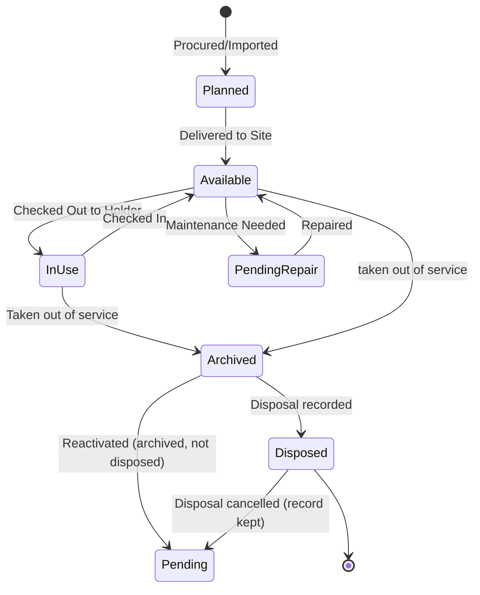

# ITAMbox

ITAMbox records hardware assets, inventory, software licenses, SaaS subscriptions, procurement and related operational data. Access to records is scoped through the application's tenant and role controls. This documentation describes the interfaces and behaviors available in the application; the [Capability Maturity](operations/capability-maturity.md) guide lists feature status and prerequisites.

## Main areas

### Organization

Manage tenants, tenant groups, sites, locations, cost centers, contacts and asset holders. Tenant scope controls which records a user can access.

### Assets

Maintain asset records and their Asset Types, manufacturers, categories, status labels, assignments, warranties and depreciation data. The application records checkout, check-in, maintenance and disposal as distinct operations.

### Inventory and stock

Track accessories, consumables and hardware components, including stock records and assignments. Quantities and allocations are managed through inventory workflows rather than through the catalogue item alone.

### Software and licenses

Maintain a software catalogue and license entitlements, including seats, encrypted product keys, expiry dates and assignments.

### SaaS subscriptions

Record subscriptions, suppliers, renewal details and seat assignments. Subscription and procurement capabilities have prerequisites; see the [Capability Maturity](operations/capability-maturity.md) guide.

### Procurement

Record purchase orders, contracts and fulfillment links. Approval, receiving and request workflows depend on the configured roles and capability status.

### Compliance

ITAMbox records custody acknowledgements and signature evidence, asset audits and maintenance history. These records support operational evidence; legal effect depends on the applicable process and jurisdiction. The stored verification hash is not a tamper-proof guarantee.

### Customization and automation

Configure custom fields, reports, alerts, webhooks and event rules. These features do not create rules, endpoints or schedules automatically. Administrators must configure and enable the relevant records; activation requirements are listed in the [Capability Maturity](operations/capability-maturity.md) guide.

### Users and authentication

Manage user accounts, role grants, API tokens and identity-provider integrations. SCIM can provision users when configured with a scoped, write-enabled token.

### Plugins

Plugins are trusted Django apps that run inside the application process; they are not sandboxed. See the [plugin guide](plugins/getting_started.md) before installing one.

---

## The System Registry & Lifecycle

Every physical asset or stock item in ITAMbox follows a strict state-governed workflow:

**Archived is not the same as disposed.** `Archived` is an operational state: the
item is out of service and its book value is frozen, but no disposal evidence
exists and the item may be reactivated through the ordinary `archived -> pending`
transition. A **disposal** is recorded as an `AssetDisposal` record (method,
data sanitization, WEEE, recipient) and always stamps the asset, archives it and
closes any active assignment in one operation. An erroneous disposal is
**cancelled** with a mandatory reason: the record stays visible as history and
the asset returns to `pending`.

### Context-Sensitive Help
Views that resolve a documentation page show a help icon (`mdi-help-circle`) in the breadcrumb header. Following it opens the corresponding page of this documentation, for example the model reference for the current list or detail view. Where no page resolves, the icon links to this overview instead. The link is a convenience, not a guarantee that every view has its own page.

### Capability Maturity
Maturity is declared per capability rather than per module, so this overview grades individual capabilities rather than whole modules. The public grades — Stable, Beta, Experimental — and the activation modes of every capability are defined in the [Capability Maturity](operations/capability-maturity.md) guide.
